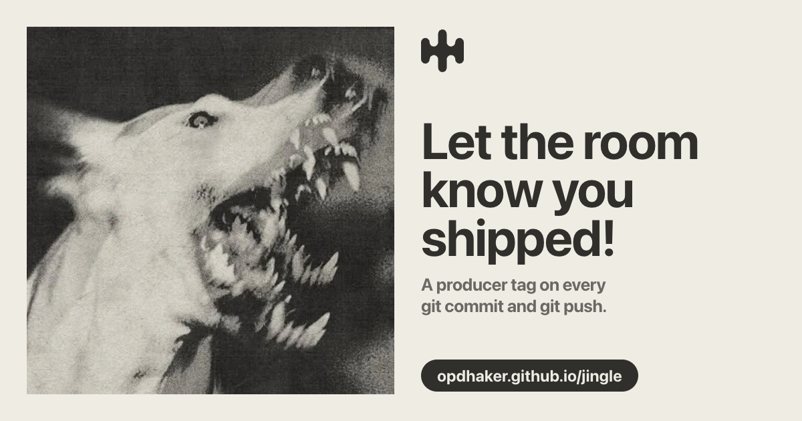
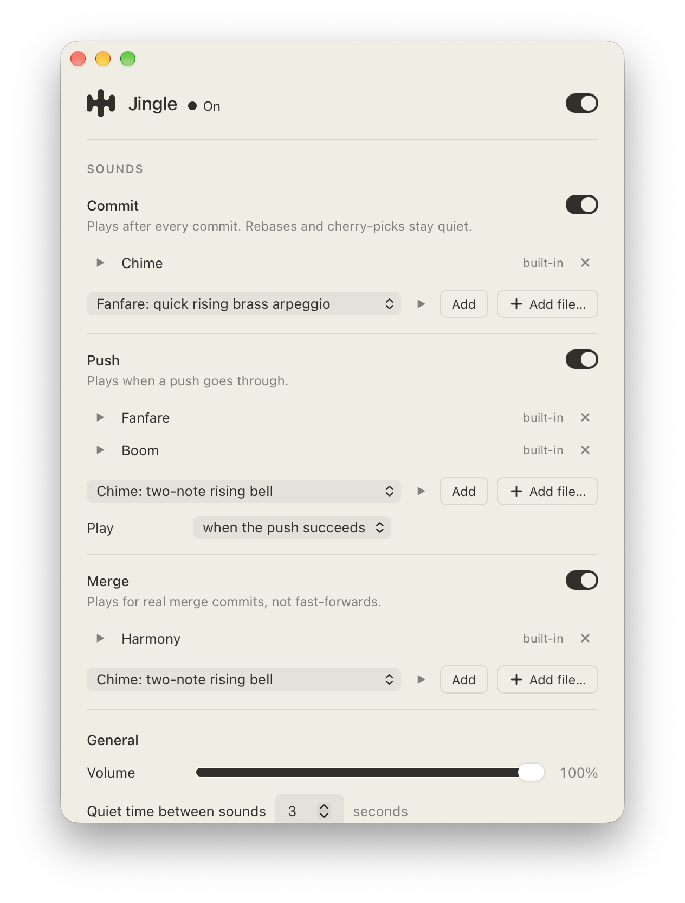
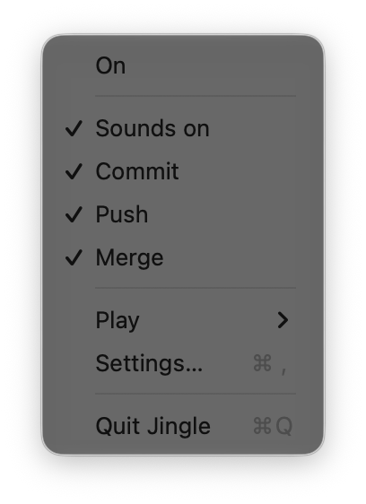
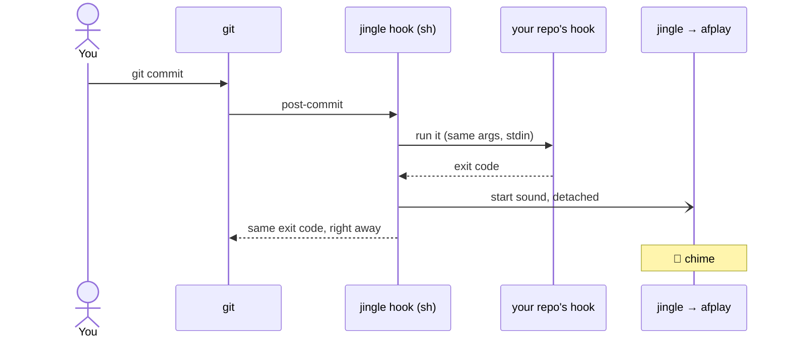

<div align="center">

<picture>
  <source media="(prefers-color-scheme: dark)" srcset="gui/assets/jingle-light.svg">
  
</picture>

# jingle

**Let the room know you shipped.**

A producer tag on every `git commit` and `git push`.<br>
Install it once. It works in every repo.

[](https://github.com/OPDhaker/jingle/releases/latest)
[](https://github.com/OPDhaker/jingle/actions/workflows/ci.yml)
[](LICENSE)
[](#install)
[](#install)
[](go.mod)

[**Website**](https://opdhaker.github.io/jingle/) ·
[Install](#install) ·
[Mac app](#mac-app) ·
[Sounds](#sounds) ·
[How it works](#how-it-works) ·
[FAQ](#faq)

<br>

<a href="https://opdhaker.github.io/jingle/"></a>

</div>

<br>

## Install

```sh
brew trust opdhaker/tap            # once; Homebrew 7 asks you to trust third-party taps
brew install OPDhaker/tap/jingle
jingle install --yes               # turn it on for every repo
```

That's it. Your next commit plays a chime, and your next successful push plays a fanfare.

<details>
<summary><b>Other ways to install</b></summary>

<br>

**Install script** (puts the binary in `~/.local/bin`, no sudo, verifies the sha256 checksum):

```sh
curl -fsSL https://raw.githubusercontent.com/OPDhaker/jingle/main/install.sh | sh
jingle install --yes
```

Set `JINGLE_VERSION=v0.1.0` to pin a version, or `JINGLE_INSTALL_DIR` to install somewhere else.

**From source** (Go 1.25+):

```sh
go install github.com/OPDhaker/jingle/cmd/jingle@latest
jingle install --yes
```

**Mac app** (also installs the CLI): see [Mac app](#mac-app).

All binaries and checksums are on [GitHub Releases](https://github.com/OPDhaker/jingle/releases/latest).

</details>

Installing the binary changes nothing on its own; `jingle install` is what turns the sound on. Check it works:

```sh
jingle play commit        # hear the commit sound now
jingle doctor             # report anything that would stop a sound
```

## Why jingle

- 🌍 **Global, set up once.** One `jingle install` covers every repo on your machine, current and future. There's nothing to add to each repo, nothing to commit, and no background process.
- 🪝 **Your hooks keep running.** Every repo's own hooks (lint, tests) still run with the same arguments, stdin, and exit code.
- ✅ **Only real wins.** The push sound plays once the push actually goes through. Rejected pushes and "Everything up-to-date" stay silent.
- 🤫 **Quiet when it should be.** Rebases, cherry-picks, and reverts don't set off a sound per replayed commit, and a burst of commits plays once.
- ⚡ **Never slows git down.** The sound plays in the background; git never waits for it. It adds a few tens of milliseconds per commit.
- 🧹 **Leaves no trace.** `jingle uninstall` puts your global git config back byte for byte.
- 🎛️ **Your sound, your signature.** Four built-in tags, or bring your own mp3, wav, aiff, m4a, ogg, or flac.
- 🤖 **Built for AI agents.** No prompts, `--json` everywhere, stable exit codes. Ask your agent to "set up jingle".

## Sounds

jingle ships four short sounds, synthesized in code (nothing to license or download). Click to listen:

| Sound | What it is | Default for |
|---|---|---|
| [▶ `chime`](https://opdhaker.github.io/jingle/src/sounds/chime.wav) | two-note rising bell | every commit |
| [▶ `fanfare`](https://opdhaker.github.io/jingle/src/sounds/fanfare.wav) | quick rising brass arpeggio | every successful push |
| [▶ `harmony`](https://opdhaker.github.io/jingle/src/sounds/harmony.wav) | two voices resolving to a chord | merge commits (opt-in) |
| [▶ `boom`](https://opdhaker.github.io/jingle/src/sounds/boom.wav) | snare hit into an 808 drop | yours to assign |

Got a producer tag? Use it. jingle keeps its own copy, so you can move or delete the original:

```sh
jingle config set commit.sounds ~/Music/my-tag.mp3
jingle config add commit.sounds ~/Music/tag2.wav    # several sounds: one plays at random
jingle config set push.sounds builtin:boom
jingle preview builtin:boom                         # try a sound before picking it
```

## Mac app

Prefer clicking? The Jingle menu-bar app does everything the CLI does.

<p align="center">
  <picture>
    <source media="(prefers-color-scheme: dark)" srcset="docs/images/settings-dark.png">
    
  </picture>
  &nbsp;&nbsp;
  <picture>
    <source media="(prefers-color-scheme: dark)" srcset="docs/images/tray-dark.png">
    
  </picture>
</p>

From the menu bar you can mute jingle, switch commit, push, and merge on or off, and play each event's sound. The settings window does the rest: install and uninstall, add, preview, and remove sounds, set the volume and cooldown, see `doctor` problems, and check a repo for husky.

It's a front end for the CLI with no logic of its own: every change runs a `jingle` command, so the app and your terminal always agree. It finds `jingle` the way your shell does, or uses `$JINGLE_BIN` if that's set.

**Homebrew** (also installs the CLI):

```sh
brew trust opdhaker/tap            # once, if you haven't already
brew install --cask OPDhaker/tap/jingle-app
```

**Download**: [`Jingle_macos_universal.dmg`](https://github.com/OPDhaker/jingle/releases/latest/download/Jingle_macos_universal.dmg) (Apple Silicon and Intel, macOS 11+), then drag Jingle to Applications and install the CLI too ([Install](#install)).

> [!NOTE]
> The app isn't notarized by Apple yet, so the first time you open the downloaded copy, macOS says it can't verify it. Open **System Settings → Privacy & Security**, scroll down, and click **Open Anyway**. You only do this once. The Homebrew install skips this.

Releases are macOS only. Linux builds in CI but hasn't been tried by hand.

## Configuration

```sh
jingle config list
jingle config set <key> <value>
jingle config add commit.sounds ~/Music/tag2.mp3
jingle config remove commit.sounds tag2.mp3
```

| Key | Default | Meaning |
|---|---|---|
| `enabled` | `true` | Master switch. `false` mutes everything but leaves the hooks installed. |
| `commit.enabled`, `push.enabled` | `true` | Per-event switches. |
| `merge.enabled` | `false` | Play on real merge commits (not fast-forwards). |
| `commit.sounds`, `push.sounds`, `merge.sounds` | `builtin:chime`, `builtin:fanfare`, `builtin:harmony` | Audio files (mp3, wav, aiff, m4a, ogg, flac) or built-in sounds. |
| `push.when` | `success` | `success`: play only when the push went through. `attempt`: play when the push starts. |
| `cooldown` | `3` | Seconds; a burst of commits plays once. |
| `volume` | `100` | 0–100. |

The config lives in `~/.config/jingle/config.toml`, and jingle's copies of your sounds in `~/.local/share/jingle/` (both honor `XDG_CONFIG_HOME` / `XDG_DATA_HOME`). Every command that changes something takes `--dry-run` to show exactly what it would do first.

## How it works

`jingle install` points git's global `core.hooksPath` at jingle's hooks dir. Each hook there first runs the hook git would have run without jingle (the repo's `.git/hooks/<name>`, or your previous global hooks path), with the same arguments, stdin, and exit status, and then starts the sound in the background.



- **Commit**: `post-commit`. Silent while a rebase, cherry-pick, or revert replays commits.
- **Push**: git has no post-push hook, so `pre-push` marks the push and the sound plays when the remote-tracking ref update proves it succeeded. A rejected or up-to-date push stays silent. Pushes to a raw URL (no remote name) play on attempt.
- **Merge** (opt-in): `post-merge`, only for real merge commits.

A hook never waits for the audio and never fails because of jingle. Audio players: `afplay` on macOS; `pw-play`, `paplay`, `aplay`, or `ffplay` on Linux (first one found).

**Limits**

- Repos that set their own `core.hooksPath` (husky and similar) override the global one, so jingle doesn't play there. `jingle doctor` inside such a repo says so.
- Success-only push detection needs git 2.28 or newer; older git plays on attempt.

## For scripts and AI agents

jingle is built to be driven without a person at the keyboard: no prompts (`--yes` confirms), `--json` on every command, stable exit codes (0 ok, 1 error, 2 usage), and idempotent commands that report `unchanged` on retry.

- **Agent skill.** Step-by-step instructions an agent follows to install, configure, check, and remove jingle. In Claude Code:
  ```
  /plugin install jingle --marketplace OPDhaker/jingle
  ```
  (or `/plugin marketplace add OPDhaker/jingle`, then `/plugin install jingle@jingle`). For any agent, once the binary is installed, `jingle skill` prints the same guide as markdown. It matches the installed version: `mkdir -p ~/.claude/skills/jingle && jingle skill > ~/.claude/skills/jingle/SKILL.md`.
- **`jingle schema`** prints every command, flag, config key (type, default, allowed values), built-in sound, and exit, error, and problem code as JSON.
- The JSON output contract is documented in [docs/json.md](docs/json.md). Every command's `--help` has examples.

## FAQ

<details>
<summary><b>Does it work in every repo?</b></summary>

Yes, with one exception. Repos that manage their own hooks with husky (or that set their own `core.hooksPath`) override jingle, so it stays silent there. `jingle doctor`, run inside the repo, tells you when this happens.
</details>

<details>
<summary><b>How do I mute it?</b></summary>

`jingle config set enabled false`. The hooks stay installed; `jingle config set enabled true` turns the sound back on. To mute only pushes: `jingle config set push.enabled false`.
</details>

<details>
<summary><b>Will it play in CI or on a server?</b></summary>

Only if the machine has an audio player. Headless machines usually don't, so it stays silent.
</details>

<details>
<summary><b>What does it need?</b></summary>

macOS (uses the built-in `afplay`) or Linux (`pw-play`, `paplay`, `aplay`, or `ffplay`), and git. Detecting a successful push needs git 2.28 or newer; on older git, the push sound plays when the push starts.
</details>

<details>
<summary><b>Windows?</b></summary>

Planned, not supported yet.
</details>

<details>
<summary><b>What if I delete the binary without uninstalling?</b></summary>

git keeps working: the hooks skip the sound and still run your own hooks. To clean up afterwards, `git config --global --unset core.hooksPath` turns jingle's hooks off (if you had your own global `core.hooksPath` before, set it back instead), and `rm -rf ~/.config/jingle ~/.local/share/jingle` removes the rest.
</details>

## Uninstall

```sh
jingle uninstall --yes --purge
```

That restores your global git config exactly as it was before `jingle install`, removes jingle's hooks, and (with `--purge`) deletes its config and imported sounds. Without `--purge`, your config and sounds are kept for a later reinstall. Then remove the binary:

```sh
brew uninstall --cask jingle-app   # menu-bar app, if installed
brew uninstall jingle              # Homebrew
rm ~/.local/bin/jingle             # install script
```

## Contributing

Issues and pull requests are welcome.

```sh
make build        # → bin/jingle
make test         # go test ./...
make lint         # golangci-lint
make gui-dev      # run the menu-bar app with hot reload (needs Rust and pnpm)
make gui-build    # → gui/src-tauri/target/release/bundle/macos/Jingle.app
```

Tests never make real sound and never touch your real `~/.gitconfig`: they run against temp dirs with `JINGLE_HOME`, `GIT_CONFIG_GLOBAL`, and a stub `JINGLE_PLAYER`.

## License

[MIT](LICENSE) © 2026 Om Pratap Dhaker

<div align="center">
<br>
<sub>If jingle made you smile, a ⭐ helps other people find it.</sub>
</div>
